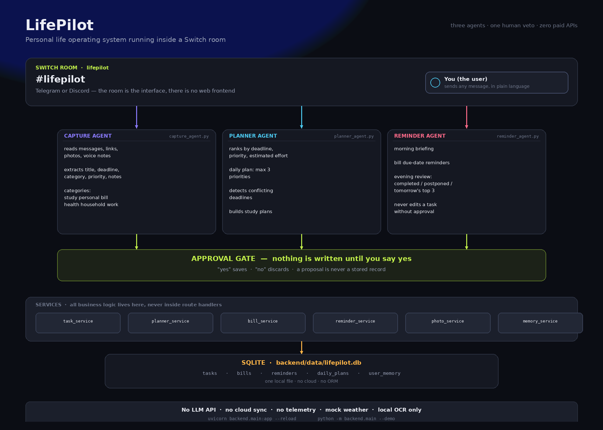

# LifePilot

**A personal life operating system that runs inside a Switch chat room.**

You send tasks, bills, photos, and half-finished thoughts in plain language. Three agents understand them, organise them, propose a plan, and ask before changing anything.

Built for the **Flip the Switch** hackathon — Telegram or Discord, three agents, one human veto.



---

## Contents

- [The problem](#the-problem)
- [How Switch fits in](#how-switch-fits-in)
- [The three agents](#the-three-agents)
- [How approval works](#how-approval-works) ← the core of the project
- [Setup, step by step](#setup-step-by-step)
- [Dynamic understanding](#dynamic-understanding-the-model-does-the-thinking) ← the LLM does the thinking
- [Automatic reminders](#automatic-reminders--you-only-ever-type-the-task) ← it speaks first
- [Import the Switch template](#import-the-switch-template)
- [Three front doors](#three-front-doors-and-which-is-the-product) ← which one is the product
- [Demo transcript](#demo-transcript)
- [Architecture](#architecture)
- [API reference](#api-reference)
- [Tests](#tests)
- [Troubleshooting](#troubleshooting)

---

## The problem

Your life is scattered across a notes app, two group chats, screenshots of handwriting, and your own memory. The bill that was due last Tuesday was never written down anywhere.

Most productivity tools answer this by taking over: they sync to a cloud, ask for an account, and quietly decide things for you. That is the wrong trade for something as personal as your life.

**LifePilot takes the opposite position: propose, never presume.** It keeps everything on your machine, shows you exactly what it understood, and refuses to change a single record until you say yes.

---

## How Switch fits in

Switch is what makes this a conversation rather than an app.

- **One room, three agents, one human.** `#lifepilot` holds you plus the Capture, Planner, and Reminder agents. Three separate roles with three separate instruction sets — not one chatbot pretending to multitask.
- **The room is the interface.** No frontend to build, host, or log into. If you have Telegram or Discord on your phone, you have LifePilot.
- **The room remembers.** Tomorrow's briefing lands where you set today's task, so context never resets.
- **Approval is enforced, not suggested.** The agents are instructed to ask; the backend *physically cannot* write without approval. Both layers agree.

Remove Switch and you have a task parser with an API. With Switch you have three agents you can argue with, in a room that persists.

---

## The three agents

| Agent | Reads | Produces | Never does |
|---|---|---|---|
| **Capture** | Messages, links, photos, voice-note transcripts | Title, deadline, category, priority, notes, effort estimate | Save before you confirm |
| **Planner** | Your open tasks | Daily plan (max 3 priorities), conflict report, study plan, postponement suggestions | Save or move a plan on its own |
| **Reminder** | Stored tasks and bills | Morning briefing, bill due-date reminders, evening review | Reschedule or delete without approval |

**Categories:** `study` · `personal` · `bill` · `health` · `household` · `work`

**Ranking rule:** nearest deadline → highest priority → least effort. The cheapest urgent thing surfaces first.

---

## How approval works

This is the part that makes LifePilot different from a productivity app, so it is worth being precise about it.

### The shape of every interaction

```
  You say something
        │
        ▼
  ┌─────────────────┐
  │  Agent proposes │  ← parses, ranks, plans. NOTHING is written.
  └────────┬────────┘
           │  "Nothing is saved yet. Reply 'yes' to save it or 'no' to discard."
           ▼
  ┌─────────────────┐
  │  You answer     │  ← yes / no. Only these two words resolve it.
  └────────┬────────┘
           │
     ┌─────┴─────┐
     ▼           ▼
   yes          no
     │           │
   wrote       discarded
```

### There are two independent layers, and both must agree

**Layer 1 — the agents ask.** Every agent's instructions in `switch/lifepilot.template.yaml` end with the same rule, and every reply states either the exact action taken or that nothing was saved.

**Layer 2 — the backend refuses.** Even if an agent ignored its instructions, it could not write anything:

| Guard | Where | What happens |
|---|---|---|
| `create_task(data, approved=False)` | `task_service.py` | Returns `{"status": "pending_approval", "preview": …}`. **No SQL runs.** |
| `POST /tasks` without `approved: true` | `main.py` | **HTTP 400** — "Capture requires confirmation" |
| `DELETE /tasks/{id}` without `?approved=true` | `main.py` | Returns `pending_approval`. Row untouched. |
| `planner_service.save(..., approved=False)` | `planner_service.py` | Returns the plan with `plan_id: null`. Nothing inserted. |
| `reminder_agent.propose_postpone(...)` | `reminder_agent.py` | Returns a pending action. Task status stays `pending`. |
| `reminder_agent.execute(action, approved=False)` | `reminder_agent.py` | Returns "Cancelled. Nothing was changed." |

That second layer is the one that matters. **A prompt can be talked around; a database constraint cannot.**

### What the pending proposal actually is

A proposal is a `Proposal` dataclass in `backend/models.py`:

```python
@dataclass
class Proposal:
    kind: str            # task | bill | plan | reminder
    summary: str
    payload: dict
    requires_confirmation: bool = True
```

It is deliberately *not* a row. It has no `id`, because it does not exist in storage yet. That is the whole design in one sentence:

> **A proposal is a thing that has not happened.**

### Over the chat API

Pending proposals are tracked per conversation, so the approval is stateful rather than decorative:

```bash
# 1. Propose — nothing saved
curl -X POST localhost:8000/chat \
  -H 'Content-Type: application/json' \
  -d '{"message":"add a task to submit lab report by Friday","sender":"room-1"}'
# → {"agent":"Capture","requires_confirmation":true, ...}

# 2. Inspect the pending proposal
curl "localhost:8000/chat/pending?sender=room-1"
# → {"pending":{"kind":"task","summary":"\"Submit lab report\" — study, ..."}}

# 3. Confirm
curl -X POST localhost:8000/chat \
  -H 'Content-Type: application/json' -d '{"message":"yes","sender":"room-1"}'
# → "Saved task #1: \"Submit lab report\" (study, due 2026-11-06)."

# …or abandon it instead — nothing is written
curl -X DELETE "localhost:8000/chat/pending?sender=room-1"
```

**A pending proposal is never silently discarded.** If you say something unrelated while a plan is waiting, the Planner says:

> *"I still have an unsaved plan waiting. Reply 'yes' to save it or 'no' to discard before we move on."*

It waits for an explicit answer. There is no path where silence equals consent.

### Why this is the right design for a life OS

Because the cost of the two failure modes is not symmetric:

- **Wrongly saving something** — you now have a fictional task in your system, quietly shaping your plan, and you have to hunt it down and delete it.
- **Wrongly asking again** — you type "yes" twice.

LifePilot always chooses the second failure.

---

## Setup, step by step

> **New to Python?** Use **[SETUP.md](SETUP.md)** instead — it walks from
> downloading the ZIP to a running app, with Windows/macOS/Linux commands.

**Requirements:** Python 3.11 or newer. Nothing else — no Docker, no API keys, no accounts.

### 1. Get the code

```bash
git clone <your-repo-url>
cd lifepilot
```

### 2. Create a virtual environment

```bash
python -m venv .venv

# macOS / Linux
source .venv/bin/activate

# Windows PowerShell
.venv\Scripts\Activate.ps1
```

### 3. Install dependencies

```bash
pip install -r requirements.txt
```

### 4. Optional: configure

```bash
cp .env.example .env
```

Nothing in `.env` is required. It exists to override the database path, timezone, and preferred briefing times.

### 5. Run the demo — the fastest way to see it work

```bash
python -m backend.main --demo
```

This needs no chat app and no network. It prints the whole workflow: Capture proposing, the user saying yes, Planner's three-priority plan with real conflict warnings, a study plan, bill reminders, the morning briefing, the evening review, and a postpone request that waits for approval.

### 6. Run the API

```bash
uvicorn backend.main:app --reload
```

| | |
|---|---|
| **The app** | http://127.0.0.1:8000/ |
| Interactive docs | http://127.0.0.1:8000/docs |
| Health check | http://127.0.0.1:8000/health |

Open `/` and the page works: type a sentence, press **Parse**, and watch the
real parser explain itself field by field. Send a message in the room and the
real agents propose, then wait for your yes. In the product, **the chat room is
the interface** — this page is the same machinery with a visible control panel.

### 7. Run the tests

```bash
pytest -q
```

```
48 passed
```

The test suite points the whole application at a temporary SQLite file (`tests/conftest.py`), so running it can never touch your real `backend/data/lifepilot.db`.

### Optional: enable photo OCR

Photo reading needs the **Tesseract binary**, which is not a Python package:

```bash
# macOS
brew install tesseract

# Ubuntu / Debian
sudo apt install tesseract-ocr
```

Without it, `/photo/tasks` answers honestly rather than pretending:

```json
{"ocr_available": false, "reply": "I can't read images on this machine because Tesseract isn't installed. Paste the text instead and I'll structure it."}
```

---

---

## Import the Switch template

`switch/lifepilot.template.yaml` defines the room, the three agents, the invited user, and the kickoff message.

1. Open **Switch Console** → template importer (or call the `create_room_from_yaml` workflow).
2. Load `switch/lifepilot.template.yaml`.
3. Fill the parameters:

   | Parameter | What to choose |
   |---|---|
   | `bridge` | your Telegram or Discord bridge |
   | `machine` | the online machine running the agents |
   | `provider` | your agent provider (e.g. `codex`) |
   | `directory` | path to this `lifepilot` folder |
   | `user` | the chat username to invite |
   | `wake_up_time` / `reminder_time` | optional briefing times |

4. Create the room.
5. **Review the generated permissions** before sending real data.
6. In the room, each agent introduces itself in one short line, and the kickoff message explains what you can say.

### What is in the template

```
version: 2
params:   bridge · machine · provider · directory · user · wake_up_time · reminder_time
resources:
  capture_agent    agent · addressing: anyone
  planner_agent    agent · addressing: anyone
  reminder_agent   agent · addressing: anyone
  lifepilot_room   room  · agents: [all three] · users: [{user}]
                   aliases · instructions · kickoff message
```

Each agent's instructions carry the full contract in its own words — what it extracts, the exact reply shape, and the one line it must always end with: *"Nothing is saved yet."*

---

## Demo transcript

Real, unedited output from `python -m backend.main --demo`:

```text
====================================================================
 LifePilot demo — no Telegram or Discord required
====================================================================

[1] Capture — parse natural language, ask before saving
Capture — I understood "Finish biology notes" — study, priority 2, due 2026-11-06, about 45 min.
Nothing is saved yet. Reply 'yes' to save it or 'no' to discard.

    User: yes
    Saved task #6: "Finish biology notes" (study, due 2026-11-06).

[2] Planner — propose a daily plan, never save without a yes
Planner — proposed plan for today:
  1. Finish biology notes — priority 1, due 2026-11-05
  2. Pay electricity bill — priority 2, due 2026-11-05
  3. 30-minute walk — priority 3, due 2026-11-05
Focus time: 85 min.
Conflicts:
  ! 2026-11-05: 3 tasks
  ! 2026-11-06: 3 tasks
  Suggested to postpone: 30-minute walk
  Suggested to postpone: Pay electricity bill
Nothing saved yet. Reply 'yes' to save this plan or 'no' to discard.

    User: yes
    Saved today's plan #1.

[3] Planner — study plan from an exam date
Planner — study plan for Biology:
  Exam: 2026-11-15 (10 days left)
  Total time: 20.0 h → 2.0 h/day
  That is a heavy daily load. Consider freeing time or splitting the subject.
Nothing saved yet. Reply 'yes' to save this plan or 'no' to discard.

    User: yes
    Saved study plan #2 for Biology.

[4] Reminder — bill due-date reminders (nothing changed)
Electricity (2,450) is due in 3 day(s).

[5] Reminder — morning briefing
Good morning. It's Thursday 05 November.
Weather: Clear skies, 15–24°C (mock).
Today's top three:
  1. Finish biology notes — study, due 2026-11-05
  2. Pay electricity bill — bill, due 2026-11-05
  3. 30-minute walk — health, due 2026-11-05
Bills to watch:
  - Electricity (2,450) is due in 3 day(s).

[6] Reminder — evening review
Evening review.
Completed today: nothing logged
Postponed: nothing
Tomorrow's top three:
  1. Submit lab report
  2. Call the landlord about water
  3. Finish biology notes

[7] Reminder — postpone asks first
    User: postpone 1 to tomorrow
    Move "Finish biology notes" to 2026-11-06? Reply 'yes' to confirm — I won't change it otherwise.

[8] Memory — stored preferences
    {'wake_up_time': '06:30', 'reminder_time': '20:30', 'study_subjects': 'Biology, Algebra',
     'bill_names': 'Rent, Internet, Electricity', 'timezone': 'Asia/Kathmandu', 'name': 'Sushil'}

====================================================================
 Demo complete. Every action above is also available over HTTP.
 Start the API with: uvicorn backend.main:app --reload
====================================================================
```

A longer walkthrough, plus a screenshot checklist for the video, is in [`assets/demo-script.md`](assets/demo-script.md).

---

## Architecture

```
        You (Telegram or Discord)
                    │
    ┌───────────────▼────────────────┐
    │   Switch room: #lifepilot      │
    │   Capture · Planner · Reminder │
    └───────────────┬────────────────┘
                    │  HTTP
    ┌───────────────▼────────────────┐
    │   FastAPI  (backend/main.py)   │  routes validate + delegate only
    └───────────────┬────────────────┘
                    │
    ┌───────────────▼────────────────┐
    │   AGENTS   ── the approval gate│  propose · ask · then act
    │   capture · planner · reminder │
    └───────────────┬────────────────┘
                    │
    ┌───────────────▼────────────────┐
    │   SERVICES ── all business logic│  task · planner · bill
    │                                 │  reminder · photo · memory
    └───────────────┬────────────────┘
                    │
    ┌───────────────▼────────────────┐
    │   SQLite   backend/data/…​.db   │  tasks · bills · reminders
    │                                 │  daily_plans · user_memory
    └────────────────────────────────┘
```

**The layering rule:** route handlers validate and delegate. Every ranking rule, every decision, and every approval gate lives in `services/` or `agents/`. Nothing business-critical sits in a route.

```text
lifepilot/
├── README.md
├── requirements.txt
├── .env.example
├── switch/
│   └── lifepilot.template.yaml     three agents · room · kickoff
├── backend/
│   ├── main.py                     FastAPI routes + --demo CLI
│   ├── database.py                 SQLite schema and connection
│   ├── models.py                   typed domain models
│   ├── schemas.py                  request/response models
│   ├── seed.py                     sample data for the demo
│   ├── services/
│   │   ├── task_service.py         parsing · approval gate · CRUD
│   │   ├── planner_service.py      ranking · conflicts · plans
│   │   ├── bill_service.py         bills · due dates · mock data
│   │   ├── reminder_service.py     briefings and reviews
│   │   ├── photo_service.py        local OCR
│   │   └── memory_service.py       user preferences
│   └── agents/
│       ├── router.py               picks the right agent
│       ├── capture_agent.py        understands · proposes · confirms
│       ├── planner_agent.py        proposes plans · asks first
│       └── reminder_agent.py       briefings · asks before changing
├── tests/
│   ├── conftest.py                 throwaway database per test run
│   ├── test_tasks.py
│   ├── test_planner.py
│   └── test_bills.py
└── assets/
    ├── architecture.png
    └── demo-script.md
```

### Design decisions worth defending

**Rule-based parsing instead of an LLM.** Deliberate, not a limitation. It means zero paid APIs, identical output on every run (critical in a live demo), and every decision auditable. `backend/agents/` is the natural seam where an LLM could drop in later without touching a single service.

**Mock weather, mocked bills, no cloud.** `reminder_service.MOCK_WEATHER` and `bill_service.MOCK_BILLS` keep the demo self-contained. Nothing leaves the machine: no sync, no telemetry, no account.

**OCR tells the truth.** If Tesseract is missing, the endpoint reports `ocr_available: false` instead of silently returning "I read nothing."

**Tests never touch your data.** `tests/conftest.py` redirects the application at a temporary database.

---

## API reference

| Method | Path | Purpose |
|---|---|---|
| `GET` | `/` | The live interface (served by the backend) |
| `GET` | `/health` | Liveness |
| `POST` | `/chat` | One message → the right agent |
| `GET` `DELETE` | `/chat/pending?sender=` | Inspect / abandon the pending proposal |
| `POST` | `/tasks/propose` | Parse text · **never saves** |
| `POST` | `/tasks/explain` | Parse text + per-field reasoning · **never saves** |
| `POST` | `/tasks` | Create · requires `approved: true` |
| `GET` | `/tasks` | List, optional `?status=` |
| `PATCH` | `/tasks/{id}` | Edit |
| `POST` | `/tasks/{id}/complete` | Mark done |
| `POST` | `/tasks/{id}/postpone` | Postpone |
| `DELETE` | `/tasks/{id}?approved=true` | Delete · approval required |
| `POST` | `/plans/daily` | Daily plan, max 3 priorities |
| `POST` | `/plans/study` | Study plan from an exam date |
| `POST` `GET` | `/bills` | Create / list bills |
| `GET` | `/bills/due` | Bills due within a window |
| `POST` `GET` | `/reminders` | Create / list reminders |
| `POST` | `/briefings/morning` | Morning briefing |
| `POST` | `/briefings/evening` | Evening review |
| `POST` | `/photo/tasks` | OCR → proposals (**never saves**) |
| `GET` `PUT` | `/memory` | Read / write preferences |
| `POST` | `/reminders/tick` | Run one scheduler pass (`?force=true` ignores the clock) |
| `GET` | `/reminders/history` | What the scheduler actually sent |
| `POST` | `/reset` | Clear local data (demo resets) |

**Preference keys:** `wake_up_time` · `reminder_time` · `study_subjects` · `bill_names` · `timezone` · `name`

### Try it with curl

```bash
# Propose, then confirm
curl -X POST localhost:8000/tasks/propose -H 'Content-Type: application/json' \
  -d '{"text":"urgent finish biology notes by Friday"}'

curl -X POST localhost:8000/tasks -H 'Content-Type: application/json' \
  -d '{"text":"urgent finish biology notes by Friday","approved":true}'

# Daily plan
curl -X POST localhost:8000/plans/daily -H 'Content-Type: application/json' -d '{"approved":true}'

# Study plan
curl -X POST localhost:8000/plans/study -H 'Content-Type: application/json' \
  -d '{"exam_date":"2026-11-15","study_hours":20,"study_subject":"Biology"}'

# Bills
curl -X POST localhost:8000/bills -H 'Content-Type: application/json' \
  -d '{"name":"Internet","amount":1200,"due_date":"2026-11-15"}'
curl localhost:8000/bills/due

# Briefings
curl -X POST localhost:8000/briefings/morning
curl -X POST localhost:8000/briefings/evening
```

---

## Tests

```bash
pytest -q
```

```
48 passed
```

| File | Covers |
|---|---|
| `test_tasks.py` | parsing, all six categories, relative dates, effort estimates, the approval gate, client-default regression, photo proposals |
| `test_planner.py` | ranking order, conflict detection, three-priority cap, postponement suggestions, study plans, invalid dates |
| `test_bills.py` | bills, due windows, overdue text, reminders, morning briefing, evening review, memory, every API route, chat routing, pending state |

Notable regression tests — each pins a bug that existed and was fixed:

- `test_client_defaults_do_not_clobber_parsed_values` — a `NOT NULL` crash when a client sent `title: null`
- `test_chat_pending_survives_until_answered` — a pending plan could be silently discarded
- `test_reminders_persist` — `create_reminder` once returned its input without saving

---

## Troubleshooting

| Symptom | Fix |
|---|---|
| `no such table` | Delete `backend/data/lifepilot.db` and restart; the schema is recreated on boot |
| `POST /tasks` returns 400 | Send `"approved": true` — that gate is intentional |
| `POST /tasks` returns 422 | Provide a `title` or `text` |
| Photo upload: `ocr_available: false` | Install Tesseract (see [setup](#optional-enable-photo-ocr)) |
| Agents not in the room | Re-import the template; confirm the machine and provider are online |
| `pytest` writes to your real DB | It shouldn't — `conftest.py` redirects it. Check for a locally set `LIFEPILOT_DB` |

---

## Privacy

Everything is local: SQLite at `backend/data/lifepilot.db`. `.env` and `*.db` are gitignored. No LLM API, no cloud sync, no telemetry, no account.

**Never commit a database containing real personal data.** The path is gitignored by default; if you want an empty schema in the repo, add it explicitly with a fresh, empty database only.

---

## License

MIT. Build on it.

---

## Open the live interface

Start the server, then open **<http://localhost:8000/>**.

```bash
uvicorn backend.main:app --reload
# → http://localhost:8000/        the app
# → http://localhost:8000/docs    the API
```

Every control on that page talks to the real backend — the same code the
Switch agents use. Nothing is mocked or decorative:

| Control | What actually happens |
|---|---|
| **Parse a sentence** | `POST /tasks/explain` → real `parse_task_text()` plus a per-field reason |
| **Sample chips** | Fills the box with a sentence that either parses well or deliberately fails |
| **Room → Send** | `POST /chat` → routes to Capture / Planner / Reminder, returns a proposal |
| **Save it / Discard** | `POST /chat` with `yes` / `no` — the only path that writes a task |
| **Tick / ×** | `POST /tasks/{id}/complete`, `DELETE /tasks/{id}?approved=true` |
| **Morning / Evening** | `POST /briefings/morning`, `POST /briefings/evening` |
| **Plan my day** | `POST /chat` with `plan my day` → Planner proposal |
| **Run scheduler now** | `POST /reminders/tick?force=true` → run a pass immediately |
| **◉ Speak** | browser speech-to-text fills the box (Chrome/Edge, real tab) |
| **Where it fails** | Runs the parser on two sentences it genuinely gets wrong, and shows why |

The page is rendered by `backend/ui.py` and served by the backend itself, so it
is same-origin with the API. The room remains the real product; this page
exists so a judge (or you) can exercise the machinery without opening a chat app.

**Colour system:** the palette is the Singh Studio (S·/·S) design system —
ink `#0c0b09`, bone `#ece7dd`, signal red `#e23b22`, mute `#9a938a`, plus the
slash brand device and mono uppercase labels.

