# LifePilot

**A local-first personal life operating system that proposes, asks, and only then saves.**

You write in plain language. LifePilot turns that into a task, bill, daily plan, or reminder, shows exactly what it understood, and waits for your **yes** before changing anything.

Built for the **Flip the Switch** hackathon: one room, three focused agents, one human veto.

`Local-first` · `No API key required` · `No account` · `133 tests passing` · `MIT`

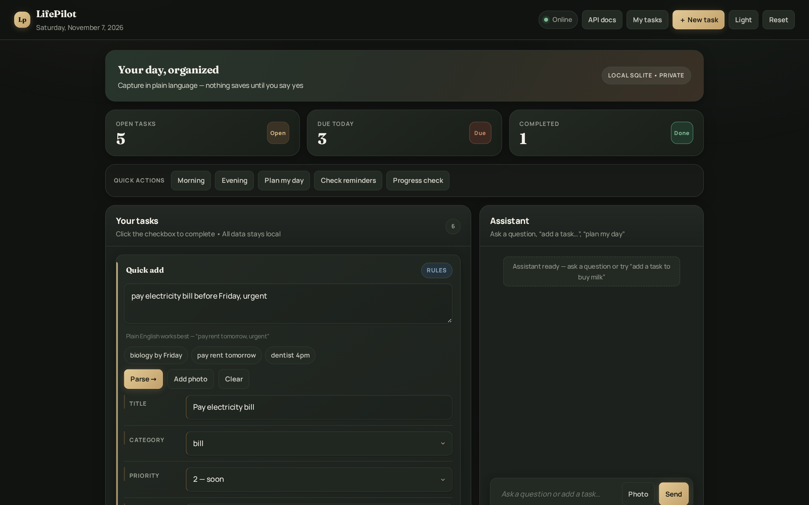

*The supplied dashboard screenshot. Every other screenshot below was captured from a running LifePilot instance with local demo data.*

---

## Contents

- [At a glance](#at-a-glance)
- [Why this is not a normal todo app](#why-this-is-not-a-normal-todo-app)
  - [Feature set](#feature-set)
- [What is LifePilot?](#what-is-lifepilot)
- [Dashboard tour](#dashboard-tour)
- [How it works](#how-it-works)
- [The approval gate](#the-approval-gate)
- [Quick start](#quick-start)
- [Your first five minutes](#your-first-five-minutes)
- [Switch integration](#switch-integration)
- [Configuration](#configuration)
- [API reference](#api-reference)
- [Project structure](#project-structure)
- [Tests](#tests)
- [Design decisions](#design-decisions)
- [Build notes](#build-notes)
- [Privacy and security](#privacy-and-security)
- [Troubleshooting](#troubleshooting)
- [FAQ](#faq)
- [Further reading](#further-reading)
- [License and credits](#license-and-credits)

---

## At a glance

| Question | Answer |
|---|---|
| **What is it?** | A single-user FastAPI application with a bundled web dashboard, an optional Switch chat room, a terminal demo, and a documented HTTP API. |
| **What is the core idea?** | **Propose → explain → ask → store.** Nothing is saved, moved, or deleted without an explicit approval. |
| **Do I need a key?** | No. Deterministic keyword rules work offline. An optional language model improves natural-language understanding. |
| **Can I ask general questions?** | Yes. Questions, greetings, and progress updates get real answers; only actionable/task-like text creates a proposal. |
| **Do I need Switch?** | No. The dashboard, CLI demo, tests, and API work independently. Switch is the conversational front door the project was built for. |
| **Where is my data?** | One SQLite file: `backend/data/lifepilot.db`. It is gitignored and never committed. |
| **What does it need?** | Python 3.10+ and `pip install -r requirements.txt`. No Docker, no database server, no signup. |
| **What is out of scope?** | Authentication, multi-user accounts, cloud sync, and hosted deployment. This is deliberately local and personal. |
| **How do I know it works?** | `pytest -q` → **133 passed**. Tests use a temporary database and need no network. |

---

## Why this is not a normal todo app

**Short answer:** a normal todo app is a list you maintain. LifePilot is an approval-first agent system that turns a sentence into a small, ranked plan and refuses to store anything until you say yes.

| Normal todo app | LifePilot |
|---|---|
| A row appears as soon as you press **Add** | A **pending proposal** appears first; only `yes` creates a row |
| Confirmation is usually a UI convention | Approval is checked again in the HTTP route **and** the service layer |
| One generic form or chatbot | Three specialised agents: **Capture**, **Planner**, **Reminder** |
| Every message becomes a possible task | General questions get real answers; only actionable/task-like text creates a proposal |
| You prioritise the list yourself | Ranking by deadline → priority → effort, capped at three priorities, with conflict warnings |
| You set reminders manually | A local clock speaks first: morning briefing, evening review, bill and due-date nudges |
| Parsing is hidden or immediate | `/tasks/explain` shows every inferred field, the reason behind it, and whether rules or a model produced it |
| Data usually lives in an account | One local SQLite file; no account, no cloud sync, no telemetry |
| One interface | Switch room, dashboard, terminal demo, and HTTP API all share one backend |
| Changes can happen quietly | Save, delete, postpone, and plan persistence all wait for explicit approval |
| Offline often means degraded | Deterministic rules are the default and need no key or network |

The important distinction is not “chat instead of clicks”. It is **propose, never presume**: the system shows its interpretation, keeps the proposal out of storage, and makes the human decision the only write path.

### Feature set

**Capture and approval**
- Plain-language tasks and bills become editable title, category, priority, deadline, time, effort, and context fields.
- Field-by-field reasoning plus a visible `RULES` / `MODEL` engine badge.
- Stateful pending proposals per `sender`/room; unrelated messages do not silently discard them.
- `POST /tasks`, `DELETE /tasks/{id}`, `POST /plans/daily`, and `POST /plans/study` enforce approval in code.
- Optional photo OCR proposes tasks from an image and reports honestly when Tesseract is unavailable.

**Planning, not just listing**
- Deadline → priority → effort ranking.
- Daily plan capped at three priorities with total focus minutes.
- Conflict detection for tasks sharing a date and suggestions for what to postpone.
- Study plans calculated from an exam date and available hours.

**Proactive reminders**
- Automatic scheduler starts with the app and checks the clock every 60 seconds by default.
- Morning briefing, evening review, upcoming bills, and due/overdue tasks.
- Periodic **progress check-in** for one open task every 4 hours by default, rotating through tasks and deduplicated per interval.
- Configurable with `LIFEPILOT_PROGRESS_INTERVAL_HOURS`; `0` disables progress check-ins.
- Manual **Progress check** button previews the current question without re-sending it.
- Deduplication ledger prevents the same nudge twice in its window.
- Every message is written to a local outbox; Discord, Slack, or Switch webhooks are optional.
- The scheduler reads tasks and bills; it never edits them.

**General assistant**
- Greetings, help requests, project questions, and progress updates are answered directly.
- Rules-mode FAQ works offline; an optional model can answer open-ended general questions.
- A status update is acknowledged but never writes to the database.
- Only actionable text reaches Capture's proposal/approval gate.

**Understanding**
- Offline keyword rules by default, with identical output on every run.
- Optional Groq, Gemini, OpenRouter, OpenAI, or local Ollama-compatible model.
- Model output is validated and clamped by Python; failures fall back to rules.
- `GET /health` reports the active engine.

**Interfaces**
- **Switch room:** three thin agents on Telegram/Discord.
- **Dashboard:** persisted dark/light theme, stats, quick actions, general Q&A, progress check preview, filters, assistant, approval panel, responsive mobile layout, embedded fonts, and no CDN dependency.
- **Terminal:** `--demo`, `--check`, and `--watch` modes.
- **API:** FastAPI with `/docs`, `/openapi.json`, and a full route table.

**Local data and preferences**
- SQLite at `backend/data/lifepilot.db`; `.env`, `*.db`, and `outbox.log` are gitignored.
- Stored preferences: `wake_up_time`, `reminder_time`, `study_subjects`, `bill_names`, `timezone`, and `name`.
- One-click **Reset** clears all local data and the outbox.

**Project quality**
- Layered architecture: routes validate and delegate; business rules live in `services/` and `agents/`.
- 133 automated tests using a temporary database and a frozen clock.
- Single-user by design: no auth, no multi-tenant hosting, no Docker requirement.

---

## What is LifePilot?

Your life is scattered across a notes app, two group chats, screenshots of handwriting, and your own memory. The bill that was due last Tuesday was never written down anywhere.

Most productivity tools solve that by taking over: they sync to a cloud, ask for an account, and quietly decide things for you. LifePilot takes the opposite position:

> **Propose, never presume.**

It keeps everything on your machine, shows you the fields it inferred, and refuses to write a record until you say yes. A proposal is a `Proposal` object in memory, not a database row. It has no ID because it has not happened yet.

### Two front doors, one backend

| Front door | Best for | What it uses |
|---|---|---|
| **Bundled dashboard** at `/` | First run, demos, quick verification, visual users | Same FastAPI routes as everything else |
| **Switch room** on Telegram/Discord | The intended conversational product | Three thin agents that call `/chat` and post the reply |
| **Terminal demo** | Seeing the full workflow without a browser | `python -m backend.main --demo` |
| **HTTP API / `/docs`** | Integration and inspection | FastAPI + OpenAPI |

The dashboard is not a mock-up. Its buttons call `/tasks/explain`, `/chat`, `/plans/daily`, `/briefings/*`, `/reminders/tick`, `/reset`, and the rest of the real API. Switch is the chat experience; the Python backend is the single source of truth.

---

## Dashboard tour

The interface is served by `backend/ui.py`, uses embedded Manrope and Fraunces fonts, and works without a CDN. It includes a persisted dark/light theme, a compact header brand, at-a-glance counters, quick actions, general-question answers, a progress check preview, an editable parser, an assistant with an approval panel, filters, and a responsive mobile layout.

| Light theme | Responsive layout |
|---|---|
| 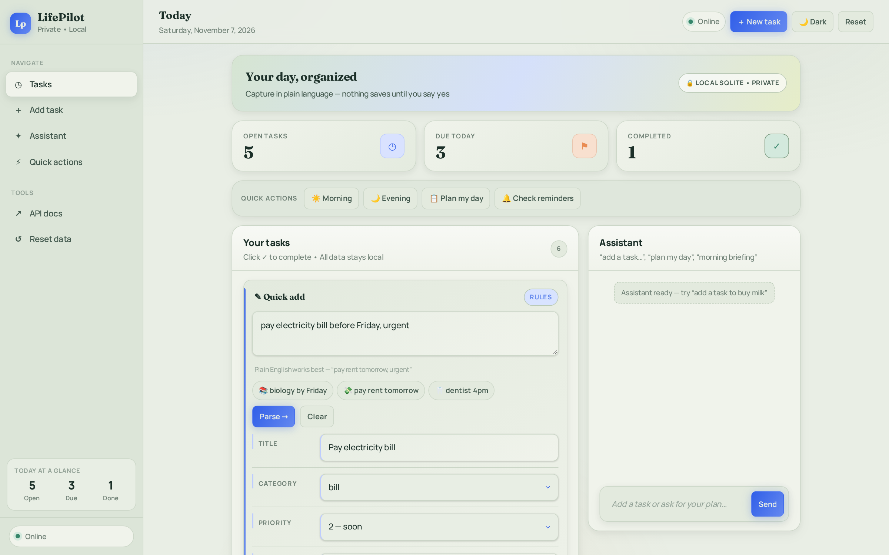 | 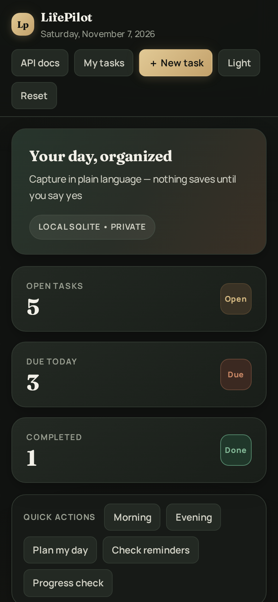 |
| *The sage/cobalt light theme, with the toggle set to “Dark”.* | *The same dashboard reflows for a narrow screen.* |

| Quick add and field-by-field understanding | Tasks, filters, and completion controls |
|---|---|
| 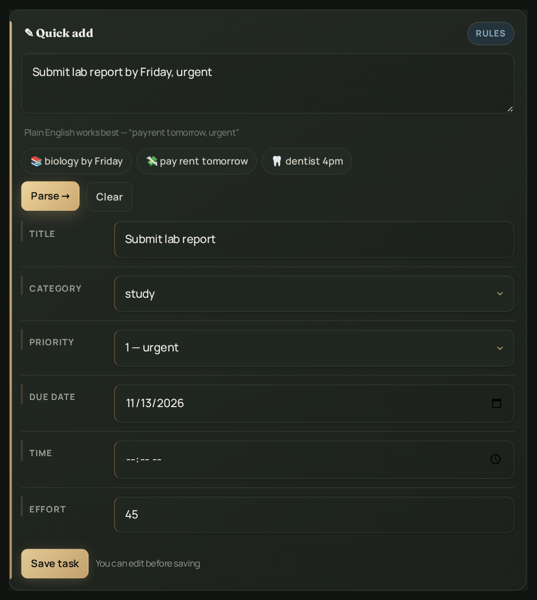 | 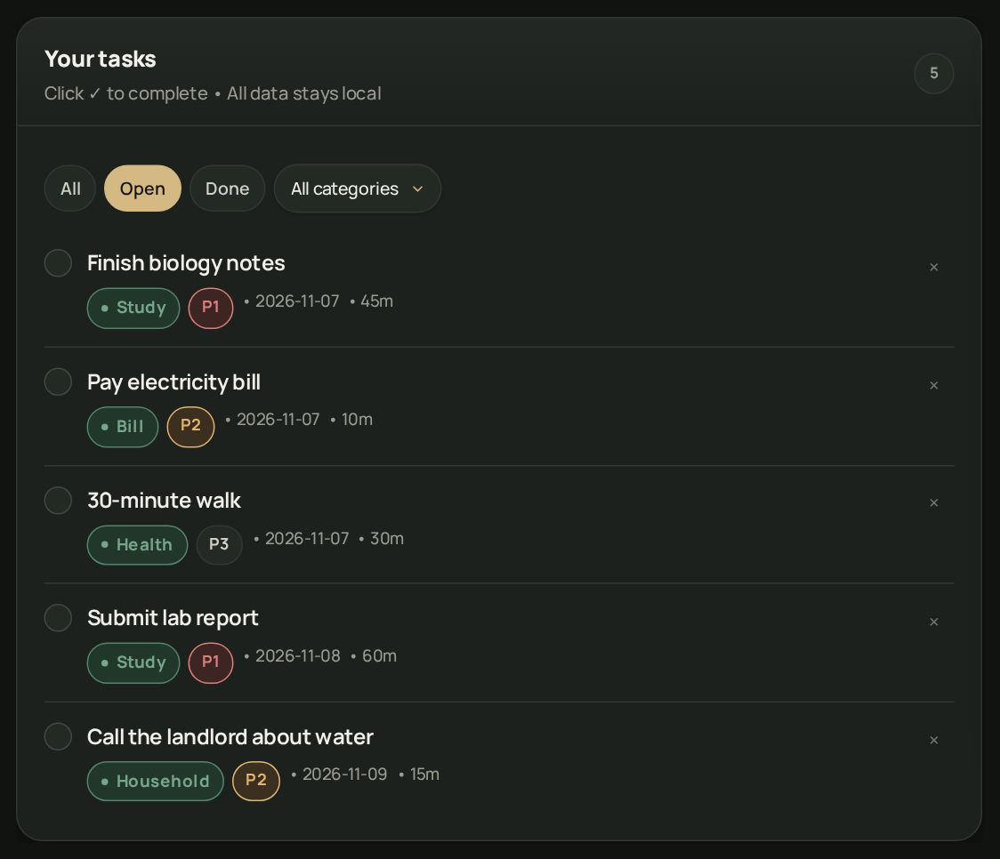 |
| *Type a sentence, press Parse, edit any field, then choose Save task.* | *Filter by status/category; click the circle to complete a task.* |

| Assistant and explicit approval | Daily plan proposal |
|---|---|
| 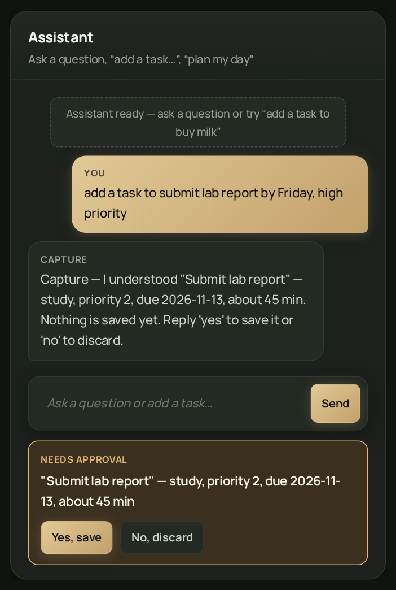 | 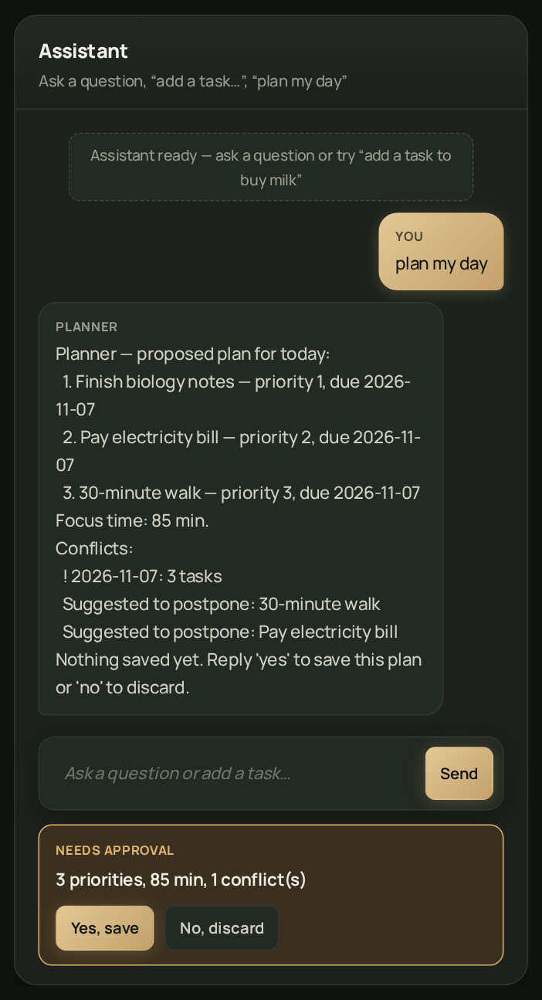 |
| *Capture explains the proposal; “Yes, save” is the only write path.* | *Planner caps the day at three priorities and flags conflicts.* |

| General questions get answers | Periodic progress check-in |
|---|---|
| 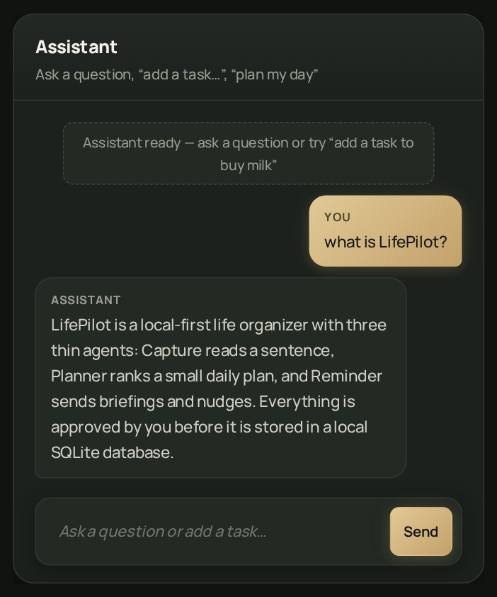 | 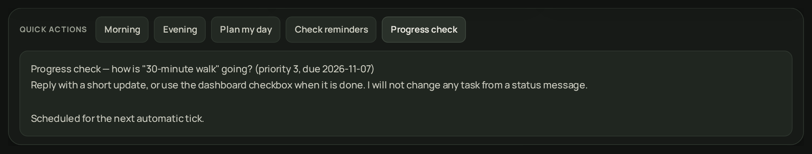 |
| *“What is LifePilot?” returns an Assistant answer, not a task proposal.* | *One open task is checked per interval; the scheduler never edits it.* |

| Morning briefing and quick actions | Interactive API documentation |
|---|---|
| 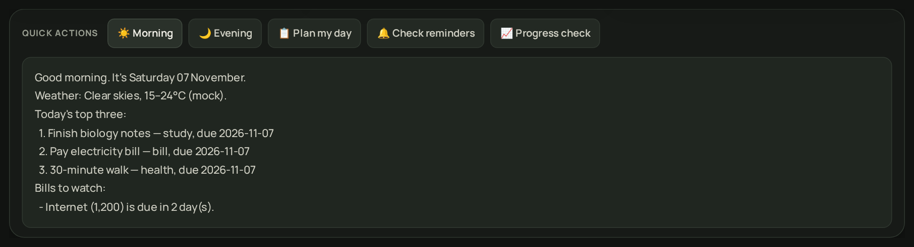 | 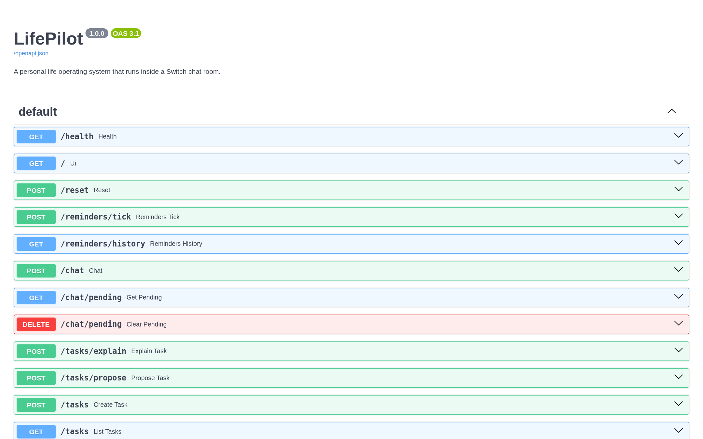 |
| *Briefings, evening review, plan, and scheduler controls sit above the workspace.* | *Every route is inspectable and callable at `/docs`.* |

---

## How it works

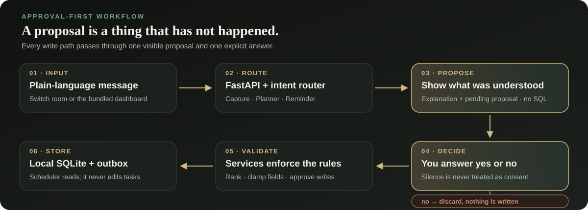

1. **You write one sentence.** It can arrive from the Switch room, the dashboard, or a direct API call.
2. **The router picks an agent or the general Assistant.** A small, deterministic router chooses Capture, Planner, Reminder, or a real answer for general questions.
3. **The agent proposes.** It returns a structured preview and a human-readable explanation. No SQL runs.
4. **You answer.** `yes`, `no`, or an explicit equivalent resolves the pending proposal. Silence never equals consent.
5. **Services enforce the rules.** Fields are validated and clamped; tasks are ranked; plans are capped; the approval flag is checked again.
6. **Only an approved action writes.** SQLite stores tasks, bills, reminders, plans, and preferences. The scheduler reads the same data and posts to a local outbox or an optional webhook.

General questions, greetings, and status updates never enter the approval gate: they receive an answer and create no proposal.

### The three agents

| Agent | Reads | Produces | Never does |
|---|---|---|---|
| **Capture** | Messages, links, photo transcripts, free-text tasks | Title, deadline, category, priority, effort, suggested time, and reasoning | Save before confirmation |
| **Planner** | Open tasks | A daily plan of at most three priorities, conflict warnings, postponement suggestions, study plans | Save or reorder a plan without approval |
| **Reminder** | Stored tasks, bills, and preferences | Morning briefing, evening review, bill due-date reminders | Reschedule, delete, or silently edit your data |

**Categories:** `study`, `personal`, `bill`, `health`, `household`, `work`

The router also has a **general Assistant** path for questions, greetings, help requests, and progress updates. It is not a fourth Switch agent and never writes data.

**Ranking rule:** nearest deadline → highest priority → least estimated effort. The cheapest urgent thing surfaces first. A daily plan is capped at three items because a list of twelve things is not a plan.

### Understanding: model optional, validation mandatory

Without configuration, `understanding_service` uses deterministic keyword rules. With `LIFEPILOT_LLM_PROVIDER` and a key, a language model may infer context such as “before bed”; every returned field is still validated and clamped by Python, and failures fall back to rules. `GET /health` always reports whether the engine is `model` or `rules`.

```text
The model may propose meaning.
The code decides what is stored.
```

---

## The approval gate

This is the part that makes LifePilot different, so it is enforced twice.

| Layer | Where | What happens without approval |
|---|---|---|
| **Conversation** | `switch/lifepilot.template.yaml` and agent replies | The agent says “Nothing is saved yet” and asks for yes/no |
| **HTTP boundary** | `POST /tasks`, `DELETE /tasks/{id}`, `POST /plans/daily`, `POST /plans/study` | `400`, a pending preview, or `plan_id: null` |
| **Service boundary** | `task_service.create_task(...)`, `planner_service.save(...)` | `{"status":"pending_approval","preview":...}` or no insert |

A prompt can be talked around; an approval flag in the code cannot. General questions are routed away from Capture entirely, so they never create a proposal in the first place.

### Example conversation

```text
You:     add a task to submit lab report by Friday, high priority
Capture: I understood "Submit lab report" (study, priority 2,
         due <resolved date>, about 45 min).
         Nothing is saved yet. Reply 'yes' to save it or 'no' to discard.

You:     yes
Capture: Saved task #1: "Submit lab report" (study, due <resolved date>).
```

If you answer `no`, the proposal is discarded. If you say something unrelated while a plan is waiting, the router asks again rather than dropping the pending proposal.

### Try it over HTTP

```bash
# 1. Create a pending proposal. Nothing is written.
curl -X POST http://localhost:8000/chat \
  -H 'Content-Type: application/json' \
  -d '{"message":"add a task to submit lab report by Friday","sender":"demo-1"}'

# 2. Inspect what is waiting.
curl 'http://localhost:8000/chat/pending?sender=demo-1'

# 3. Approve it. Only now is a row inserted.
curl -X POST http://localhost:8000/chat \
  -H 'Content-Type: application/json' \
  -d '{"message":"yes","sender":"demo-1"}'

# …or abandon it without writing anything.
curl -X DELETE 'http://localhost:8000/chat/pending?sender=demo-1'
```

Pending proposals are tracked per `sender`, so separate rooms or browser sessions cannot approve each other’s work by accident.

---

## Quick start

> **New to Python?** Follow **[SETUP.md](SETUP.md)** instead. It covers installing Python, opening a terminal in the right folder, Windows activation, and first-run errors in much more detail.

### Requirements

- Python **3.10 or newer**
- No Docker, no API key, no account, and no external database
- About a minute for `pip install -r requirements.txt`

### 1. Get the code

```bash
git clone <your-repo-url>
cd lifepilot
```

If you received a ZIP instead, unzip it and `cd` into the folder that directly contains `README.md` and `backend/`.

### 2. Create and activate a virtual environment

```bash
# Windows
python -m venv .venv
.venv\Scripts\activate

# macOS / Linux: use python3 if python points to an older version
python3 -m venv .venv
source .venv/bin/activate
```

You should see `(.venv)` at the start of your prompt. Reactivate it in every new terminal.

### 3. Install dependencies

```bash
pip install -r requirements.txt
```

### 4. Run the terminal demo

```bash
python -m backend.main --demo
```

This is the fastest way to understand the product. It creates a deterministic sample day and prints Capture’s proposal, the user’s yes, a three-priority plan, conflict warnings, a study plan, bill reminders, briefings, a postpone request that waits for approval, and a scheduler pass. It needs no browser, no chat app, and no network.

### 5. Start the app

```bash
uvicorn backend.main:app --reload
```

| Address | What you get |
|---|---|
| <http://localhost:8000/> | Dashboard |
| <http://localhost:8000/docs> | Interactive API reference |
| <http://localhost:8000/openapi.json> | OpenAPI schema |
| <http://localhost:8000/health> | Liveness, understanding engine, and reminder-clock status |

`uvicorn` starts the automatic reminder clock inside the app. Keep the terminal open while using the dashboard.

> `python -m backend.main` also starts a server, but binds to `0.0.0.0:8000`. For ordinary local use, prefer the `uvicorn` command above. See [Privacy and security](#privacy-and-security).

### 6. Run the tests

```bash
pytest -q
```

```text
133 passed
```

Tests point the application at a temporary SQLite file, so they never touch `backend/data/lifepilot.db`.

### Other useful commands

| Command | Purpose |
|---|---|
| `python -m backend.main --check` | Print a setup report; hides any API key |
| `python -m backend.main --watch --interval 30` | Run the reminder clock as a separate process |
| `python -m backend.main --demo` | Reset to a sample day and print the workflow |
| `pytest -q` | Run all 133 tests |
| `deactivate` | Leave the virtual environment |

---

## Your first five minutes

1. Open **<http://localhost:8000/>**.
2. In **Quick add**, type `pay electricity bill before Friday, urgent` and press **Parse →**.
3. Review the editable title, category, priority, due date, time, and effort. The `RULES` or `MODEL` badge tells you which engine produced them.
4. Press **Save task**. This calls `POST /tasks` with `approved: true`; nothing was stored before this click.
5. In **Assistant**, type `what is LifePilot?`. You get a real answer from **Assistant**, with no **Needs approval** panel.
6. In **Assistant**, type `plan my day`. Planner proposes three priorities and shows a **Needs approval** panel. Choose **Yes, save** or **No, discard**.
7. Try **Morning**, **Evening**, **Check reminders**, and **Progress check** in Quick actions.
8. Toggle **Light / Dark** in the header; the choice is saved in `localStorage`.
9. Use **Reset** only when you want to clear all local tasks, bills, reminders, plans, preferences, and the outbox.

---

## Switch integration

Switch makes LifePilot a conversation instead of a web form. The three agents are intentionally thin: they do not parse dates, rank tasks, or keep state. They call this backend over HTTP and post the exact reply they receive.

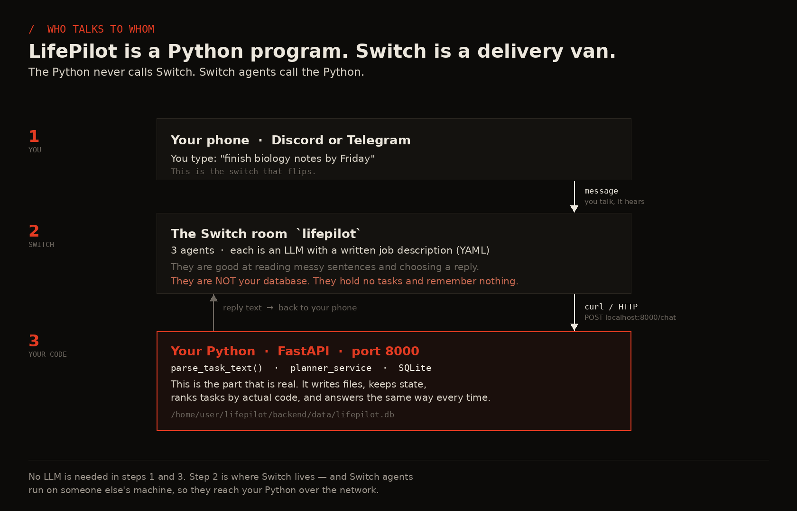

*Reference diagram from the original repository: the Python program never calls Switch; Switch agents call the Python program.*

### How the room is organised

- **One shared room:** `lifepilot`, connected to a Telegram or Discord bridge.
- **Three agents:** Capture, Planner, and Reminder, each with its own instructions and sender id.
- **One user:** invited by username.
- **One shared contract:** show what was understood, ask before acting, never claim a write that did not happen.

Because all rules live in the backend, the room, dashboard, CLI, and API cannot disagree.

### Import the template

`switch/lifepilot.template.yaml` defines the room, the three agents, aliases, permissions, and the kickoff message.

1. Start the backend on the machine the agents can reach:

   ```bash
   cd /path/to/lifepilot
   uvicorn backend.main:app --host 0.0.0.0 --port 8000
   ```

2. Open **Switch Console → template importer**, or use the `create_room_from_yaml` workflow.
3. Load `switch/lifepilot.template.yaml`.
4. Fill the parameters:

   | Parameter | What to choose |
   |---|---|
   | `bridge` | Your Telegram or Discord bridge |
   | `machine` | The online machine running the agents |
   | `provider` | Agent provider, for example `codex` |
   | `directory` | Absolute path to this `lifepilot` folder |
   | `user` | Chat username to invite |
   | `wake_up_time` / `reminder_time` | Optional briefing times, 24-hour `HH:MM` |

5. Create the room and **review the generated permissions** before sending real data.
6. In the room, try: `add a task: finish biology notes by Friday`, then reply `yes`.

The agents call `POST /chat` with a stable `sender` value. That sender is how the backend keeps each conversation’s pending proposal separate.

---

## Configuration

Everything is optional. Copy the example file and edit only what you need:

```bash
cp .env.example .env       # macOS / Linux
copy .env.example .env     # Windows
```

`.env` is gitignored. Never paste a key into a terminal command, chat message, screenshot, or demo video.

### Understanding engine

```dotenv
LIFEPILOT_LLM_PROVIDER=groq
LIFEPILOT_LLM_API_KEY=paste-your-key-here
LIFEPILOT_TIMEZONE=Asia/Kathmandu
```

Supported providers include `groq`, `gemini`, `openrouter`, `openai`, and a local `ollama`-compatible endpoint. Leave `LIFEPILOT_LLM_MODEL` and `LIFEPILOT_LLM_BASE_URL` blank unless you need to override the provider default. One key is enough for all three agents because they are behaviours, not separate services.

Without a provider, keyword rules are used and the app works fully offline. `GET /health` reports the active mode.

### Reminders and delivery

| Variable | Default | Purpose |
|---|---|---|
| `LIFEPILOT_TICK` | `1` | `0` disables the in-app automatic clock |
| `LIFEPILOT_TICK_INTERVAL` | `60` | Seconds between scheduler checks |
| `LIFEPILOT_TASK_WINDOW` | `1` | Days ahead to warn about a task |
| `LIFEPILOT_BILL_WINDOW` | `3` | Days before a bill’s due date to start reminding |
| `LIFEPILOT_PROGRESS_INTERVAL_HOURS` | `4` | Hours between periodic progress check-ins; `0` disables them |
| `LIFEPILOT_DISCORD_WEBHOOK` | blank | Optional Discord delivery |
| `LIFEPILOT_SLACK_WEBHOOK` | blank | Optional Slack delivery |
| `LIFEPILOT_SWITCH_WEBHOOK` | blank | Optional Switch webhook delivery |

Every reminder is always written to `backend/data/outbox.log`. A webhook adds an external destination; it never replaces the local record. The scheduler reads tasks and bills and writes only its own delivery ledger. It never edits a task.

### Storage, timezone, and OCR

| Variable | Default | Purpose |
|---|---|---|
| `LIFEPILOT_DB` | `backend/data/lifepilot.db` | Override the SQLite path |
| `LIFEPILOT_TIMEZONE` | `Asia/Kathmandu` | Default timezone for briefing/reminder times |
| `TESSERACT_CMD` | auto-detected | Path to Tesseract if it is installed somewhere unusual |

Photo OCR is optional and requires the **Tesseract binary**, not just the Python package:

```bash
brew install tesseract                 # macOS
sudo apt install tesseract-ocr        # Ubuntu / Debian
```

`POST /photo/tasks` proposes tasks from an image and never saves them. If OCR is unavailable, the endpoint reports `ocr_available: false` rather than pretending it read the image.

---

## API reference


Open **<http://localhost:8000/docs>** for request schemas, response models, and a “Try it out” button on every route.

### Core and conversation

| Method | Path | Purpose |
|---|---|---|
| `GET` | `/` | Dashboard HTML |
| `GET` | `/docs` | Swagger UI |
| `GET` | `/openapi.json` | OpenAPI schema |
| `GET` | `/health` | Liveness, understanding engine, reminder clock |
| `POST` | `/reset` | Clear local data and outbox |
| `POST` | `/chat` | One message → correct agent → reply/proposal |
| `GET` | `/chat/pending?sender=` | Inspect the pending proposal |
| `DELETE` | `/chat/pending?sender=` | Discard a pending proposal |

### Tasks and understanding

| Method | Path | Purpose |
|---|---|---|
| `POST` | `/tasks/explain` | Parse text and return per-field reasoning; never saves |
| `POST` | `/tasks/propose` | Capture proposal; never saves |
| `POST` | `/tasks` | Create a task; requires `approved: true` |
| `GET` | `/tasks?status=` | List tasks, optionally filtered by status |
| `PATCH` | `/tasks/{id}` | Edit a task |
| `POST` | `/tasks/{id}/complete` | Mark done |
| `POST` | `/tasks/{id}/postpone` | Postpone |
| `DELETE` | `/tasks/{id}?approved=true` | Delete; approval required |

### Plans, bills, briefings, and extras

| Method | Path | Purpose |
|---|---|---|
| `POST` | `/plans/daily` | Build/save a daily plan; max three priorities |
| `POST` | `/plans/study` | Build/save a study plan from an exam date |
| `POST` / `GET` | `/bills` | Create/list bills |
| `GET` | `/bills/due?days=7` | Bills due within a window |
| `POST` / `GET` | `/reminders` | Create/list reminders |
| `POST` | `/briefings/morning` | Morning briefing |
| `POST` | `/briefings/evening` | Evening review |
| `POST` | `/photo/tasks` | OCR → proposals, never saves |
| `GET` / `PUT` | `/memory` | Read/write user preferences |
| `POST` | `/reminders/tick?force=true` | Run one scheduler pass immediately |
| `POST` | `/reminders/progress` | Preview the current progress question without re-delivering it |
| `GET` | `/reminders/history?limit=20` | What the scheduler actually sent |

**Preference keys:** `wake_up_time`, `reminder_time`, `study_subjects`, `bill_names`, `timezone`, `name`.

### A short curl walkthrough

```bash
# Parse, but do not save.
curl -X POST http://localhost:8000/tasks/propose \
  -H 'Content-Type: application/json' \
  -d '{"text":"urgent finish biology notes by Friday"}'

# Save only with the approval flag.
curl -X POST http://localhost:8000/tasks \
  -H 'Content-Type: application/json' \
  -d '{"text":"urgent finish biology notes by Friday","approved":true}'

# Build and save a plan.
curl -X POST http://localhost:8000/plans/daily \
  -H 'Content-Type: application/json' -d '{"approved":true}'

# Study plan, bills, and briefings.
curl -X POST http://localhost:8000/plans/study \
  -H 'Content-Type: application/json' \
  -d '{"exam_date":"2026-11-20","study_hours":20,"study_subject":"Biology"}'

curl -X POST http://localhost:8000/bills \
  -H 'Content-Type: application/json' \
  -d '{"name":"Internet","amount":1200,"due_date":"2026-11-15"}'

curl http://localhost:8000/bills/due
curl -X POST http://localhost:8000/briefings/morning
curl -X POST http://localhost:8000/briefings/evening
```

---

## Project structure

```text
lifepilot/
├── README.md                       this guide
├── SETUP.md                        beginner, click-by-click installation guide
├── requirements.txt                pinned Python dependencies
├── .env.example                    optional settings template
├── pytest.ini
├── assets/
│   ├── workflow.svg                approval-first workflow diagram
│   ├── architecture.png            original hackathon architecture reference
│   ├── how-switch-connects.png     Switch/backend relationship
│   ├── where-the-switch-is.png     thin-agent design reference
│   ├── demo-script.md              two-minute demo narration
│   └── screenshots/                dashboard and feature screenshots
├── switch/
│   └── lifepilot.template.yaml     room, three agents, aliases, kickoff message
├── backend/
│   ├── main.py                     FastAPI routes, CLI demo/check/watch
│   ├── ui.py                       self-contained dashboard HTML/CSS/JS
│   ├── database.py                 SQLite schema, migrations, reset
│   ├── models.py                   typed domain models
│   ├── schemas.py                  Pydantic request/response models
│   ├── env_loader.py               .env + timezone helpers
│   ├── seed.py                     deterministic sample day
│   ├── agents/
│   │   ├── router.py               intent routing + approval state
│   │   ├── capture_agent.py        understands, proposes, confirms
│   │   ├── planner_agent.py        proposes plans, asks first
│   │   └── reminder_agent.py       briefings, asks before changing
│   ├── services/
│   │   ├── task_service.py         parsing, approval gate, CRUD
│   │   ├── understanding_service.py rules/model validation and fallback
│   │   ├── llm_service.py           optional provider integration
│   │   ├── planner_service.py      ranking, conflicts, plans
│   │   ├── bill_service.py         bills and due dates
│   │   ├── reminder_service.py     briefings and reviews
│   │   ├── scheduler_service.py    automatic, deduplicated pushes
│   │   ├── ticker_service.py       in-app clock lifecycle
│   │   ├── deliver_service.py      outbox + optional webhooks
│   │   ├── photo_service.py        local OCR
│   │   └── memory_service.py       user preferences
│   └── data/
│       ├── .gitkeep
│       ├── lifepilot.db            generated local database, gitignored
│       └── outbox.log              generated reminder log, gitignored
└── tests/
    ├── conftest.py                 temporary database per test run
    ├── test_tasks.py
    ├── test_planner.py
    ├── test_bills.py
    ├── test_reminders.py
    ├── test_template.py
    ├── test_understanding.py
    └── yaml_shim.py                PyYAML/ruamel compatibility
```

**Layering rule:** route handlers validate and delegate. Ranking, parsing, approval gates, scheduling, and storage live in `services/` and `agents/`, never in a route.

---

## Tests

```bash
pytest -q
# 133 passed
```

| Area | Covered by |
|---|---|
| Parsing, categories, relative dates, approval gate, CRUD, photo proposals | `test_tasks.py` |
| Ranking, conflicts, three-priority cap, study plans | `test_planner.py` |
| Bills, briefings, reviews, memory, routes, chat routing | `test_bills.py` |
| Automatic scheduler, date-sensitive reminders, and progress check-ins | `test_reminders.py` |
| General-question routing and optional model answers | `test_general_assistant.py` |
| Switch template contract | `test_template.py` |
| Rules/model understanding and validation | `test_understanding.py` |

The suite uses a throwaway SQLite database through `tests/conftest.py`. Date-sensitive reminder tests use a frozen clock, so the result does not change with the calendar day. A harmless Starlette/httpx deprecation warning may appear depending on the installed package versions.

---

## Design decisions

- **The model decides meaning; the code decides storage.** An optional LLM may read a sentence, but Python validates every field and checks the approval flag before any SQL runs.
- **A plan is capped at three.** Deadlines, priority, and effort are ranked in code; conflict warnings group tasks sharing a date.
- **Agents are thin.** They call the backend and post its reply verbatim. One implementation of each rule means chat and API cannot disagree.
- **Reminders are read-only.** The scheduler reads tasks and bills and writes only its delivery ledger. It never completes, postpones, or deletes a task.
- **Rules mode is a feature.** Zero paid APIs, identical output on every run, and an auditable parse make demos reproducible.
- **General questions are not tasks.** The router answers them directly; only actionable text reaches the approval gate.
- **No cloud required.** Mock weather and sample bills keep the demo self-contained. Fonts are embedded; no CDN is needed for the dashboard.
- **Tests never touch your data.** A temporary database and frozen clock make the suite safe and deterministic.
- **Single-user by design.** No login, no tenant model, no hosted sync. That boundary keeps the project small and honest.

---

## Build notes

These are the practical lessons from the build, kept because they help the next person.

- **The agent subscription ran out.** Switch itself was not the problem; the metered subscription behind each agent did. Because the agents only call a backend, the dashboard, CLI, and API kept working.
- **A model was retired.** A provider removed free access to a model mid-build. `LIFEPILOT_LLM_MODEL` lets you override provider defaults without editing code.
- **A SQLite file lock only appeared on Windows.** Connections that were not closed looked fine on Linux/macOS but broke cleanup on Windows. Every connection now closes itself.
- **Two tests only passed on one calendar day.** They compared fixed dates with `date.today()`. The reminder tests now freeze the clock and sample tasks are built at call time, so the suite passes on any day.
- **OCR tells the truth.** If Tesseract is missing, `/photo/tasks` says `ocr_available: false`; it does not claim to have read an empty image.
- **Approval is not just a prompt.** `POST /tasks` returns `400` without `approved: true`, and `task_service.create_task(..., approved=False)` returns a preview with no insert.
- **General questions used to become fake tasks.** The original chat router fell through to Capture for every message. A dedicated Assistant path and task-intent heuristics now keep Q&A out of the proposal flow.
- **Progress check-ins needed their own dedupe.** A periodic question is keyed by task, date, and interval bucket; the manual button previews it instead of sending it again.

---

## Privacy and security

- Tasks, bills, plans, reminders, and preferences live in `backend/data/lifepilot.db`.
- `.env`, `*.db`, `*.db-journal`, and `backend/data/outbox.log` are gitignored.
- The dashboard has no external stylesheet, script, font, or analytics request.
- Without an LLM provider or webhook configured, no application data leaves the machine. If you configure one, the corresponding text is sent to that provider/destination; storage still stays local.
- There is **no authentication**. The app is intended for localhost or a trusted private network. Do not expose port 8000 to the public internet.
- CORS is permissive so the same-origin dashboard and Switch/preview clients can reach the API; this is a local-development convenience, not a public API gateway.
- **Never commit a database containing real personal data.** Use **Reset** or `POST /reset` to clear local data before sharing a project archive.

---

## Troubleshooting

| Symptom | Likely cause | Fix |
|---|---|---|
| `ModuleNotFoundError: No module named 'fastapi'` | Virtual environment is not active or packages are missing | Activate `.venv`, then `pip install -r requirements.txt` |
| `ModuleNotFoundError: No module named 'backend'` | You are one directory above the project | `cd` into the folder containing `backend/` |
| `Address already in use` on port 8000 | Another process is listening | `uvicorn backend.main:app --reload --port 8001`, then open `localhost:8001` |
| `POST /tasks` returns `400` | Approval flag missing | Send `"approved": true`; this gate is intentional |
| `POST /tasks` returns `422` | No `title` and no `text` | Provide one of them |
| `no such table` | An old/incompatible database file | Stop the app, delete `backend/data/lifepilot.db`, restart; schema is recreated on boot |
| Dashboard badge says `RULES` | No model key was found | Optional; check `.env` and `python -m backend.main --check`, then restart |
| `401` / `Invalid API key` | Provider rejected the key | Create a new key and keep it only in `.env` |
| `ocr_available: false` | Tesseract binary is not installed | Install Tesseract; see [Configuration](#configuration) |
| Switch agents cannot answer | Backend is not reachable from the agent machine | Confirm `uvicorn` is running on that machine and port 8000 is reachable |
| Tests appear to use your real DB | A `LIFEPILOT_DB` override leaked into the test environment | Unset it; `conftest.py` normally redirects to a temporary file |
| `source: command not found` on Windows | macOS/Linux activation command used | Use `.venv\Scripts\activate` |

Still stuck? Run `pytest -q`. If all 133 tests pass, the code is fine and the problem is environmental.

---

## FAQ

**Do I need an API key?**  
No. Rules mode works offline. A key only improves natural-language understanding.

**Do I need Telegram, Discord, or Switch?**  
No. They provide the intended chat experience, but the dashboard, demo, tests, and API are complete on their own.

**Will a general question create a task?**  
No. Questions, greetings, help requests, and progress updates go to the Assistant. Only actionable/task-like text creates a proposal.

**How often does LifePilot ask about progress?**  
By default, one open task is checked every 4 hours during your configured active hours. Set `LIFEPILOT_PROGRESS_INTERVAL_HOURS` to another value, or `0` to disable it. The manual **Progress check** button only previews the current question.

**Can I use it completely offline?**  
Yes, with the default rules mode and no webhooks. `/docs` may use CDN assets in a browser, but the app itself does not need them.

**Is it multi-user?**  
No. It is a single-user, local-first system. There is no login or account model.

**Where do screenshots and diagrams live?**  
In `assets/screenshots/` and `assets/`. All are referenced relatively, so the README works in a cloned repository.

**How do I start over?**  
Use the dashboard’s **Reset** button or `POST /reset`. It clears tasks, bills, reminders, plans, preferences, the delivery ledger, and the outbox.

**Does it use Docker?**  
No. A virtual environment and `uvicorn` are enough.

**Why does every save need `yes`?**  
Because wrongly saving a fictional task quietly shapes your plan; wrongly asking again only costs one extra word. LifePilot always chooses the second failure.

---

## Further reading

- [SETUP.md](SETUP.md): beginner installation guide for Windows, macOS, and Linux
- [assets/demo-script.md](assets/demo-script.md): two-minute demo narration and screenshot checklist
- [switch/lifepilot.template.yaml](switch/lifepilot.template.yaml): the complete room/agent definition
- [assets/architecture.png](assets/architecture.png), [assets/where-the-switch-is.png](assets/where-the-switch-is.png), and [assets/how-switch-connects.png](assets/how-switch-connects.png): original hackathon reference diagrams
- <https://github.com/sandbox-quantum/switch>: Switch, the open-source agent/room layer

> The original diagrams are kept for historical context. A few show earlier test counts or the pre-optional-model design; the current behaviour and test count are described in this README.

---

## License and credits

MIT. Build on it.

Built by our team for the **Flip the Switch** hackathon, run by WeMakeDevs, DevTools Academy, and Switch. This README merges the original repository guide, the newer visitor-oriented draft, and the current dashboard implementation.
